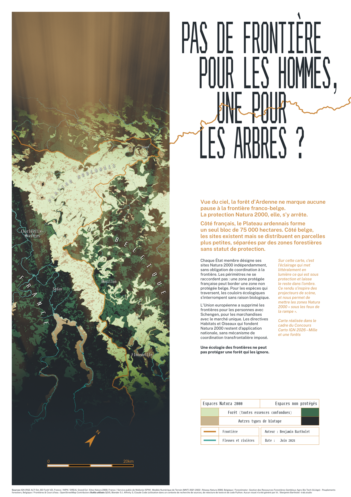
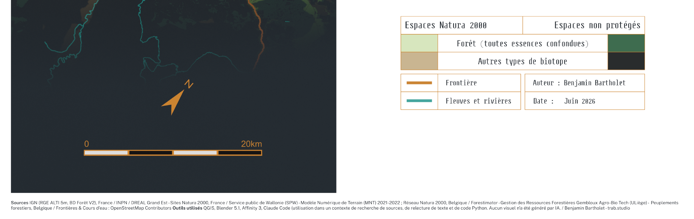
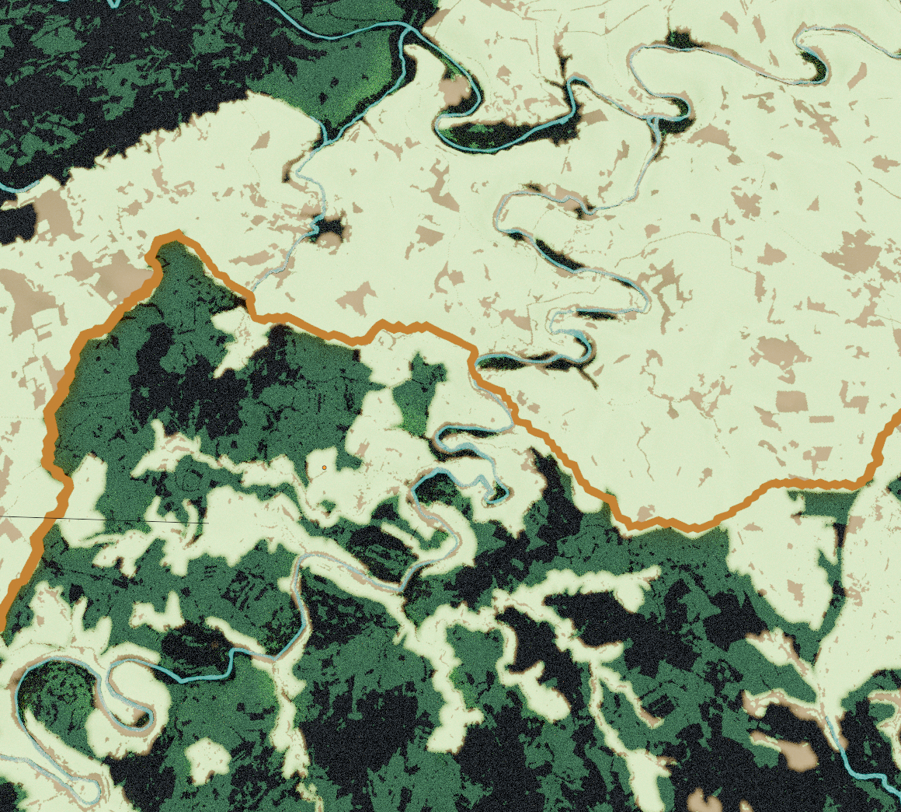
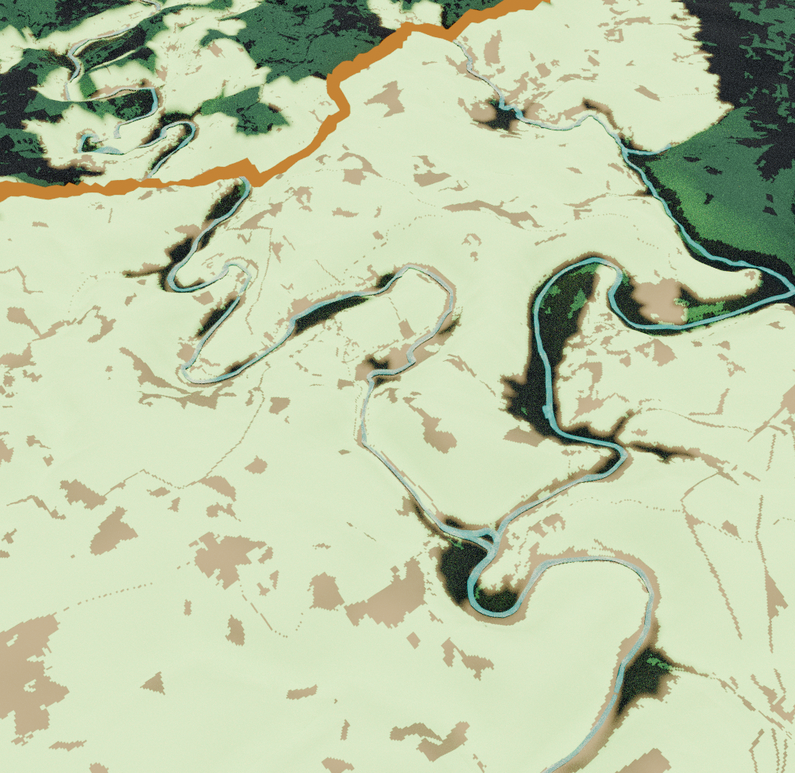
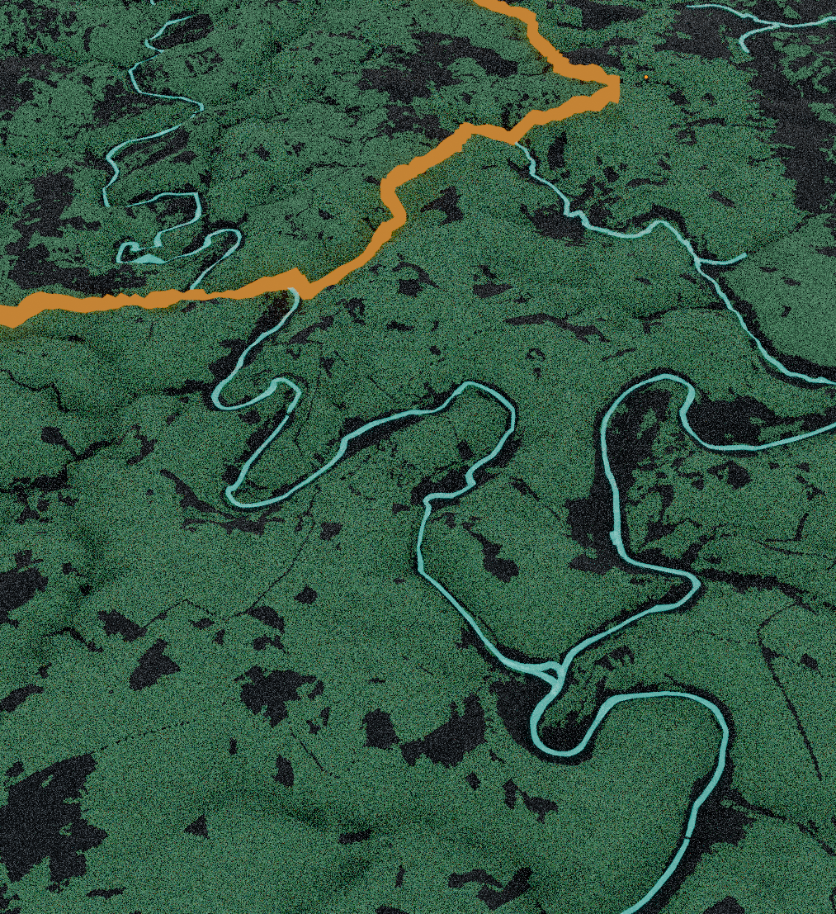
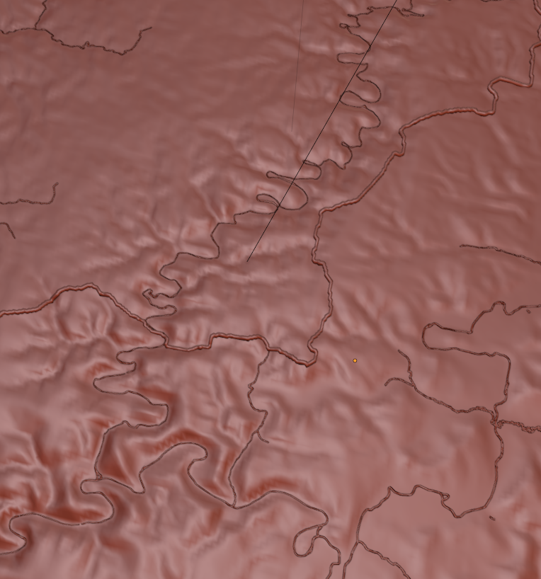
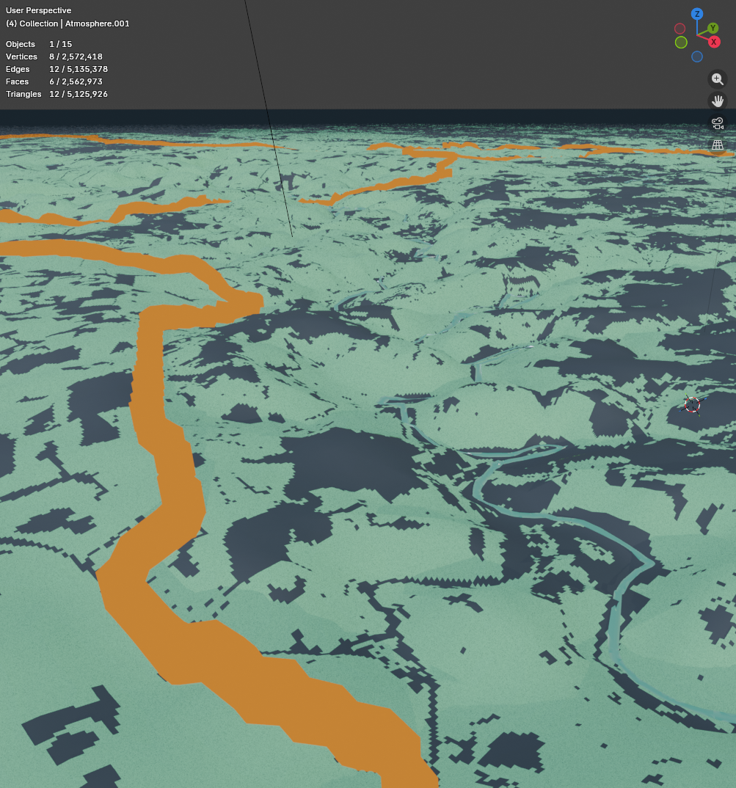

# Pas de frontière pour les hommes, une pour les arbres ?

*No border for people, one for trees.*

A 3D relief map of the cross-border Ardennes massif, France and Belgium, submitted to the **IGN Cartography Competition 2026** on the theme "Mille et une forêts". A1 portrait poster, 594 × 841 mm, June 2026.



📄 [Full-resolution poster (PDF)](https://drive.google.com/file/d/1d7_ktCymUfDaL2s1MDju72X62SsKJJz-/view?usp=sharing) · 🗺️ IGN Cartography Competition 2026

## About

Seen from above, the Ardennes forest crosses the French-Belgian border without a pause. Natura 2000 protection stops there.

On the French side, the Plateau ardennais forms a single block of 75,000 hectares. On the Belgian side the sites exist too, but they break into smaller parcels separated by stretches of forest that carry no protected status. Each member state designates its own Natura 2000 sites with no obligation to coordinate at the border, so the perimeters do not join up: a protected French zone can sit against an unprotected Belgian one. For species that move across, the ecological corridors stop for no biological reason.

The European Union removed borders for people with Schengen and for goods with the single market. The Habitats and Birds directives that Natura 2000 rests on stayed national, with no cross-border coordination mechanism imposed.

> Une écologie des frontières ne peut pas protéger une forêt qui les ignore.

**The map argues this with light.** Stage lighting picks out what sits under protection and leaves the rest in shadow, so you read every protection edge as a lighting boundary. Forest inside a protected site comes up pale green, other biotopes inside it come up sand. The same forest outside protection goes dark green, and the rest of the unprotected ground goes near black. The border runs as an orange thread, rivers as cyan.



| | | |
|---|---|---|
|  |  |  |
| A protection edge following the border | The same break, seen obliquely | Terrain without lighting |

## Pipeline

Elevation and forest data come from two national providers that share neither grid, projection, nor resolution, so most of the QGIS work goes into making the two halves of the massif comparable.

1. **Elevation.** RGE ALTI 5 m (IGN) for France, assembled from the D008 tiles through a GDAL virtual raster (`data/processed/rgealti_d008.vrt`). MNT 1 m (SPW, 2021–2022) for Wallonia, Luxembourg and Namur provinces. Both reprojected and resampled onto a common grid, then clipped to the working extent (`data/processed/dept08.shp`).

2. **Forest cover.** BD Forêt V2 (IGN) for France. Forestimator peuplements forestiers (Gembloux Agro-Bio Tech, ULiège) for Belgium, a 239 MB raster vectorised and reclassified so the two inventories answer the same question: forest or not, all species merged.

3. **Natura 2000.** Sites from INPN and DREAL Grand Est for France, Réseau Natura 2000 for Belgium. The two networks are merged into a single perimeter layer, then rasterised into the mask that drives the lighting. This mask is the whole argument of the map, so it is the one layer that has to be right on both sides of the line.

4. **Border and rivers.** OpenStreetMap. The border is buffered and cleaned by hand in QGIS (`data/processed/frontiere_buffer_clean.gpkg`), since the raw line carries the survey noise of a boundary drawn through woodland and that noise reads as texture at poster scale. Waterways are sorted into two tiers (`data/rivers/rivers_major.json`, `rivers_minor.json`), and Blender gives each tier its own bevel, 0.03 and 0.012, so the hierarchy survives at print size.

5. **Blender 5.1.** Cycles GPU, around 2.5 M vertices. The terrain is a displaced plane driven by the merged DEM. The Natura 2000 mask lights it, the forest masks colour it. Scale bar and north arrow are modelled as scene objects so they take the same light as the terrain.

6. **Affinity Publisher 3.** Poster layout, typography, title block, legend, export to A1 PDF.

| | |
|---|---|
|  |  |
| Terrain without lighting, vector layers overlaid | Blender viewport, masks driving the material |

## Data sources

| Dataset | Provider | Coverage |
|---|---|---|
| RGE ALTI 5 m, BD Forêt V2 | IGN | France |
| Sites Natura 2000 | INPN, DREAL Grand Est | France |
| MNT 2021–2022, Réseau Natura 2000 | Service public de Wallonie (SPW) | Belgium |
| Peuplements forestiers (Forestimator) | Gembloux Agro-Bio Tech, ULiège | Belgium |
| Borders and waterways | OpenStreetMap contributors | Both |

All of it is open data. Reproducing the derived layers means downloading these sources into `data/raw/` and replaying steps 1 to 4.

## Repository structure

```
├── assets/          poster export and Blender captures
├── data/
│   ├── processed/   working layers (the heavy clips are not tracked)
│   ├── raw/         source downloads, 23 GB, not tracked
│   └── rivers/      OSM waterways sorted into two tiers
├── output/          final exports, not tracked
└── sources/         Blender, Affinity and QGIS masters, not tracked
```

`sources/` and `data/raw/` stay out of Git. The Blender scene, the Affinity documents and the full-resolution render run from 70 MB to 232 MB each, above what GitHub accepts, and every raw dataset is downloadable from the providers listed above.

## Tools

QGIS, Blender 5.1, Affinity 3, Claude Code. I used Claude Code to research sources, proofread text and write Python. No AI generated any visual.

## Typefaces

[Steps Mono](https://velvetyne.fr/fonts/steps-mono/) by Jean-Baptiste Morizot and Raphaël Bastide, released by Velvetyne, for the legend and title block. [Public Sans](https://github.com/uswds/public-sans) by the U.S. Web Design System, for the body text. Both under the SIL Open Font License 1.1.

## Credits

Analysis & Design: **Benjamin Bartholet** · [trab.studio](https://trab.studio) · [github.com/telohtrab](https://github.com/telohtrab)
